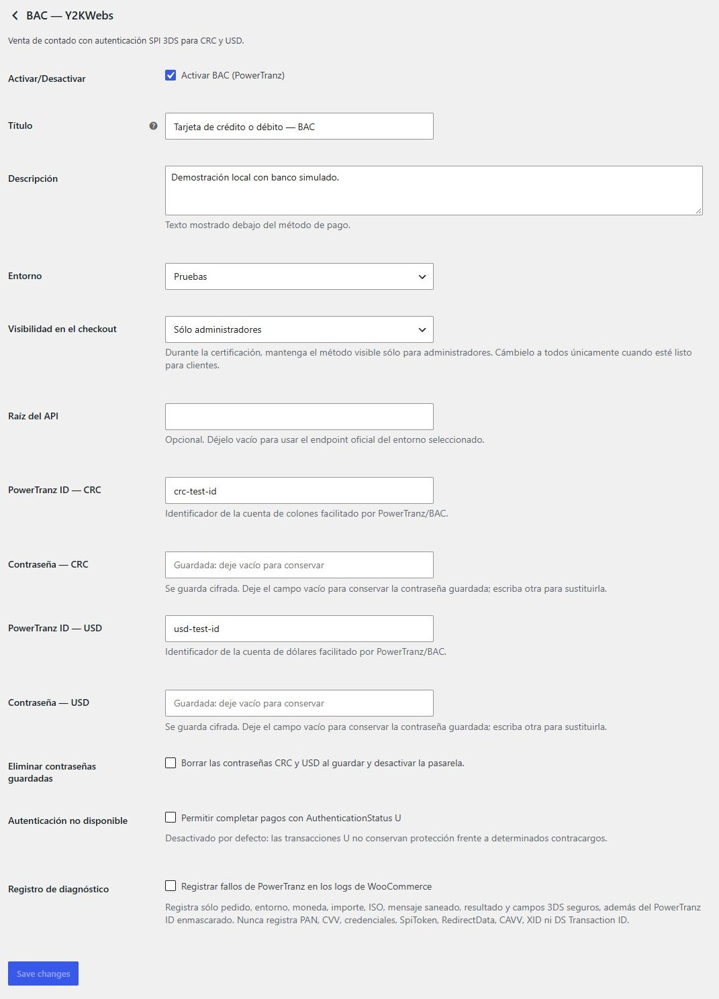

# Y2KWebs Gateway for BAC

Plugin independiente, gratuito y de código abierto para aceptar pagos con tarjeta de **BAC Costa Rica en WooCommerce**, mediante **PowerTranz/FAC SPI 3DS**, desarrollado por [Y2KWebs](https://y2kwebs.com/). Sin registro obligatorio, suscripción, telemetría ni anuncios en el checkout.

[Versión 1.0.0 y descargas](https://github.com/Y2KWebs/y2kwebs-bac/releases/tag/v1.0.0) · [Instalación y soporte profesional](https://y2kwebs.com/) · [Reportar un problema](https://github.com/Y2KWebs/y2kwebs-bac/issues/new/choose)

**Versión 1.0.0 — primera edición pública.** Se comprobaron pagos reales Visa y Mastercard, cada una en USD y CRC, y el mantenedor verificó las cuatro aprobaciones también en el portal bancario. Las pruebas automatizadas utilizan un banco simulado. Staging sigue pendiente; se está preparando el envío a WordPress.org, todavía sin solicitud presentada. Consulta los [resultados y limitaciones](docs/validation.md). Es una integración independiente, no un plugin oficial de BAC, PowerTranz o WooCommerce ni una afirmación de respaldo del banco.

La interfaz de la pasarela y las guías están en **español**, sin instalar traducciones. El `readme.txt` se mantiene en inglés por requisito de WordPress.org. La interfaz inglesa y las traducciones oficiales del directorio se posponen; el idioma de WordPress y WooCommerce se configura por separado.

## Funcionalidades

- Cuentas CRC y USD configurables desde **WooCommerce → Ajustes → Pagos → BAC — Y2KWebs**. Las contraseñas se guardan cifradas y no vuelven a mostrarse en formularios ni respuestas API. No hace falta editar `wp-config.php`.
- Selección de la cuenta bancaria según la moneda del pedido, con importes de dos decimales y sin conversión automática.
- Checkout clásico y de bloques, con autenticación SPI 3DS y presentación del desafío del emisor cuando corresponde.
- Comprobación de transacción, referencia, importe, moneda y aprobación financiera antes de marcar el pedido como pagado.
- Protección frente a solicitudes concurrentes o duplicadas. Los resultados financieros inciertos mantienen el pedido en espera para conciliación manual.
- Compatibilidad con HPOS y almacenamiento clásico; diagnósticos opcionales con campos sensibles excluidos.

**Limitaciones:** admite ventas de contado. No incorpora devoluciones bancarias automáticas, suscripciones, tarjetas guardadas, cuotas ni consulta automática de estado bancario. La cobertura se limita a BAC Costa Rica mediante cuentas PowerTranz/FAC SPI compatibles; no se afirma compatibilidad con otros países, todos los productos BAC o todas las marcas. Consulta la [cobertura comprobada](docs/validation.md).

## Así se integra

Configuración de BAC desde el administrador de WooCommerce:

Captura del entorno local con cuentas ficticias. Las contraseñas guardadas no se muestran en el formulario.

## Requisitos e instalación

Requisitos mínimos: WordPress 6.9, WooCommerce 9.0, PHP 7.4, OpenSSL con AES-256-GCM, HTTPS y MySQL/MariaDB con `GET_LOCK`. Las versiones efectivamente verificadas están en [validación](docs/validation.md); los mínimos no implican que se hayan probado todas las combinaciones posteriores.

1. Instala WooCommerce y configura HTTPS, enlaces permanentes y la moneda de la tienda: CRC o USD.
2. Descarga el ZIP instalable **`y2kwebs-bac-1.0.0.zip`** desde la [release 1.0.0](https://github.com/Y2KWebs/y2kwebs-bac/releases/tag/v1.0.0). El ZIP de código fuente generado por GitHub no es el paquete de instalación verificado.
3. Sube el paquete desde **Plugins → Añadir plugin → Subir plugin** y actívalo.
4. Abre **WooCommerce → Ajustes → Pagos → BAC — Y2KWebs** e introduce **PowerTranz ID** y **Contraseña** de la cuenta CRC, USD o ambas, según tu contrato bancario.
5. Selecciona el entorno correspondiente a esas credenciales y guarda. Las contraseñas se cifran; dejar sus campos vacíos conserva los valores guardados. No se necesitan archivos privados de configuración.
6. Realiza una prueba controlada con visibilidad **Sólo administradores**. La instalación comienza desactivada y en staging. **Producción realiza cobros reales**, incluso si la pasarela solo es visible para administradores; esa visibilidad no impone un límite de importe.
7. Habilita la pasarela para todos los clientes únicamente después de comprobar su configuración y los resultados. Sigue la [guía de operación](docs/pilot.md).

Cada comercio necesita su propio contrato BAC/PowerTranz, las monedas y marcas habilitadas y credenciales SPI del entorno seleccionado. Las comisiones y condiciones bancarias son independientes del plugin. La [configuración detallada](docs/configuration.md) explica conservación, sustitución y eliminación de contraseñas, además de las alternativas opcionales para instalaciones administradas.

## Datos de pago y resultados inciertos

En SPI directo, el formulario envía los datos de tarjeta al servidor de la tienda mediante HTTPS y este los transmite a PowerTranz en memoria. El plugin no guarda PAN, CVV ni tokens SPI. Revisa con el adquirente los requisitos PCI DSS aplicables y evita capturar cuerpos HTTP en servidor, proxy, WAF o herramientas de diagnóstico. La [ficha del plugin](readme.txt) detalla el servicio externo y los datos transmitidos.

Excluye checkout, pago de pedidos y `wc-api/y2kwebs_bac_callback` de caché. Permite el retorno POST bancario. La autenticación se correlaciona con el pedido y un estado aleatorio de un solo uso; una aprobación 3DS por sí sola no marca el pedido como pagado.

Si un resultado financiero es incierto, **no repitas el cobro ni borres metadatos para reabrir el intento**. Comprueba primero la operación en el portal bancario. Las devoluciones se gestionan mediante el banco y se registran manualmente en WooCommerce. Consulta la [guía de operación y conciliación](docs/pilot.md).

## Documentación y desarrollo

- [Configuración desde WooCommerce](docs/configuration.md)
- [Arquitectura y flujo de pago](docs/architecture.md)
- [Pruebas bancarias controladas](docs/pilot.md)
- [Resultados de validación y pendientes](docs/validation.md)
- [Desarrollo y pruebas locales](docs/development.md)
- [Preparación y comprobación de releases](docs/releasing.md)
- [Preparación y envío a WordPress.org](docs/wordpress-org.md)
- [Seguridad y revisión de contenido público](SECURITY.md)
- [Cómo contribuir](CONTRIBUTING.md)

El repositorio conserva pruebas y herramientas para que la comunidad pueda revisar y reproducir el comportamiento. El ZIP instalable incluye únicamente los archivos seleccionados del plugin y su documentación. Los ejemplos y fixtures son ficticios; las suites locales interceptan las solicitudes bancarias y no realizan cobros. No ejecutes fixtures en tiendas reales.

## Soporte e instalación profesional

[Y2KWebs ofrece instalación, configuración y soporte profesional para WooCommerce](https://y2kwebs.com/), mediante acuerdo separado. El plugin puede utilizarse gratuitamente sin contratar estos servicios, crear una cuenta Y2KWebs ni suscribirse. El soporte comunitario no tiene SLA.

Para incidencias, indica versiones, pasos con datos ficticios y el código genérico del diagnóstico. Nunca publiques credenciales, tarjetas, CVV, cookies, respuestas bancarias completas ni URLs con tokens. Para vulnerabilidades, sigue [SECURITY.md](SECURITY.md).

Licencia [GPL-2.0-or-later](LICENSE). Se conserva la atribución a JARS Costa Rica por la integración histórica de referencia. Las marcas BAC, PowerTranz/FAC y WooCommerce pertenecen a sus respectivos titulares.
